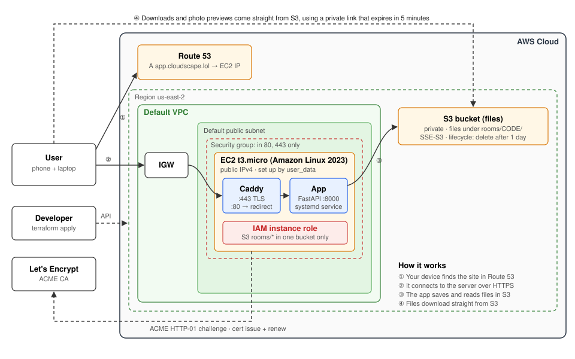

# CloudDrop: Cloud Computing Project 1

Move files between your phone and laptop through a short room code. Start a
room, scan its QR code on the other device, and anything uploaded shows up on
both. Files are deleted automatically after 24 hours.

It runs on an EC2 instance, stores files in S3, is reached through a Route 53
domain over HTTPS (Let's Encrypt), and uses an IAM role scoped to `rooms/` in
one bucket. Everything is created with Terraform.

**Live endpoint:** https://app.cloudscape.lol

| Deliverable | File |
|---|---|
| Live endpoint | https://app.cloudscape.lol |
| Architecture diagram | [docs/architecture.svg](docs/architecture.svg) |
| Cost estimate (3 traffic levels) | [docs/cost-estimate.md](docs/cost-estimate.md) |
| Written report | [docs/report.md](docs/report.md) |



## Layout
```
app/      FastAPI web service (main.py) and S3 wrapper (storage.py)
infra/    Terraform: EC2, security group, S3 (+ lifecycle rule), IAM role, Route 53 record
tests/    pytest suite (S3 faked with moto)
docs/     architecture diagram, cost estimate and report
```

## Run the tests
```bash
python3 -m venv .venv
.venv/bin/pip install -r requirements-dev.txt
.venv/bin/pytest -q
```

## Deploy
Prerequisites: an AWS account, the AWS CLI signed in (`aws configure`),
Terraform, and a domain whose nameservers point at a Route 53 hosted zone.

```bash
cp infra/terraform.tfvars.example infra/terraform.tfvars   # set domain + email
terraform -chdir=infra init
terraform -chdir=infra apply
```
The instance installs the app and Caddy on first boot. The site is ready
about 3 minutes later; Caddy gets the TLS certificate on the first request.

## Tear down
```bash
terraform -chdir=infra destroy
```
The Route 53 hosted zone was created by hand. Delete it in the console if you
no longer need it ($0.50/month).
